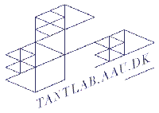
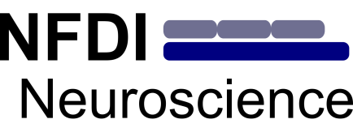
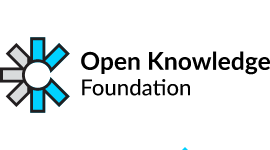
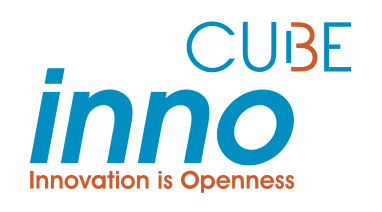
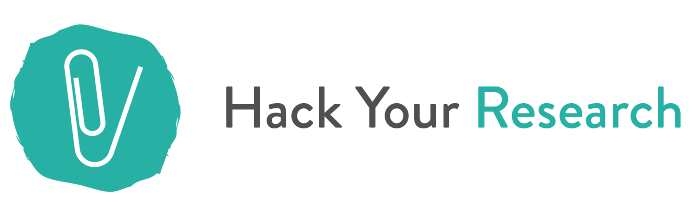

<!-- DEVROOM: CALL (2027) -->

<section id="call-for-presentations" class="section" markdown="1">
  

    <h2 class="title">Call for Participation</h2>

**👉 Deadline 16 November 2026**

### Call for presentations

We invite **developers and users of open tools and technologies** used in a research and investigation context to contribute to the 2027 edition of [FOSDEM](https://fosdem.org): **scientific research, investigative journalism, data journalism, OSINT, as well as research and investigations undertaken by NGOs, civil society, community and activist groups**, etc.

We seek talks about:

- **New releases of open source software**. Introduce a new tool or infrastructure about knowledge production or management. We appreciate context about the project, at the crossroads of open source software and open science.
- **Present and/or ask for feedback on open technology stacks** used in a knowledge creation or production project (research, journalistic inquiry, archive creation or publication…) which collects, analyses, treats, documents, visualizes, and/or shares data.
- **Discuss tool design and implementation** that enhance the understanding and literacy of inquiry outputs: data visualisation techniques and issues, knowledge access and exploration means. E.g., how to hold an algorithm accountable to social scientists; how to foster better reproducibility and interoperability thanks to FLOSS; or how to cope with biases of a chart for a data journalist.
- **Contribute to the debate about bridging tech culture with research** and investigative environments (data journalism, investigative journalism, activism and academia), including tips and best practices for navigating tensions, as well as the contribution of the open source movement to research and investigations sustainability through organizational hosting, funding for projects, support and maintenance, etc.)
- **Share your experience** about building open source devices or communities across a variety of research and investigative contexts.

We welcome talks from various research and investigative contexts: research labs, libraries, newsrooms, museums, hackerspaces, maker labs, community and activist groups. We welcome your experience on various topics: open science, open data, commons, research on research, sustainability… Any subjects related to open source technologies in research contexts are welcome even if not in this list.

</section>

<section id="talks-format" class="section" markdown="1">
  

    <h2 class="title">Event and talks format</h2>

Our devroom consists of about 8 hours of talks held physically in Bruxelles on **Saturday 30 January 2027**.

#### 1. Talks

* *Lecture* talks will last **20 minutes** followed by **10 minutes** for questions (and changing speaker)
* *Lightning* talks will last **10 minutes** followed by **5 minutes** for questions (and changing speaker)

Talks have to be *in English* and will be recorded and later on published under Creative Commons CC-BY license on the FOSDEM video recordings archive <https://video.fosdem.org/>.

#### 2. Event format

The FOSDEM will be held physically in Bruxelles. The presenters have to be present in person, but the talks can be seen online via a live stream.

  

</section>

<section id="submission" class="section" markdown="1">
  

    <h2 class="title">Submission</h2>

# HOW TO SUBMIT

#### 1. Important dates:

- **Proposal Deadline: 16 November 2026 AOE**
- Accepted talk announced: 1 December 2026
- **FOSDEM Conference: 30-31 January 2027** at Université libre de Bruxelles, Solbosch campus. **This devroom is on the 30th**, morning + afternoon.
- Submit early if you can!

#### 2. Submissions

Must include:

- Title
- Abstract
- Description
- Talk license: FOSDEM is an open-source software conference, please specify which OSI approved license your proposal uses.
- Speaker name, contact, biography and availability

Can include:

- Submission notes: write if you want to give a Lightning talk or Lecture here. Add any other details as needed (visible only to devrooms managers)
- Session Image: Use this if you want an illustration to go with your proposal. Please do not upload files larger than 10.0 MB.
- Additional speaker: you can add co-authors
- Extra review material: private materials you want to show to reviewers

Please make sure to add links to relevant online materials (such as website, publications, code repository…) to either abstract or extra review material.
   

To get inspired on possible abstract styles, length and format, you can read previous edition talks on FOSDEM archives:

- [Open Research @ FOSDEM 2026](https://archive.fosdem.org/2026/schedule/track/open-research/)
- [Open Research @ FOSDEM 2025](https://archive.fosdem.org/2025/schedule/track/research/)
- [Open Research @ FOSDEM 2024](https://archive.fosdem.org/2024/schedule/track/open-research/)
- [Open Research @ FOSDEM 2023](https://archive.fosdem.org/2023/schedule/track/open_research_tools_and_technology/)
- [Open Research @ FOSDEM 2022](https://archive.fosdem.org/2022/schedule/track/open_research_tools_and_technologies/)
- [Open Research @ FOSDEM 2021](https://archive.fosdem.org/2021/schedule/track/open_research_tools_and_technologies/)
- [Open Research @ FOSDEM 2020](https://archive.fosdem.org/2020/schedule/track/open_research_tools_and_technologies/)

#### 3. How to submit your proposal (Pretalx tips)

The submission process is managed in the Pretalx system used by the FOSDEM conference. You must create an account in the system to submit. Once logged in, select “submit a CFP” and select the “Open research” track.

**Apply for a talk: [https://pretalx.fosdem.org/fosdem-2027/cfp](https://pretalx.fosdem.org/fosdem-2027/cfp)**

...Then select the track "Open Research".

If you have any issues with Pretalx, do not despair: contact us at [open-research-devroom-manager@fosdem.org](mailto:open-research-devroom-manager@fosdem.org).

Follow us [on Mastodon (@FosdemResearch@fosstodon.org)](https://fosstodon.org/web/@FosdemResearch) for updates and announcements.

  

</section>

<section id="about" class="section" markdown="1">
  

    <h2 class="title">About the Devroom</h2>

# About the Open Research devroom

The Open Research devroom addresses [FLOSS](https://www.gnu.org/philosophy/floss-and-foss.en.html) developers in a broad community concerned with research production and curation: scientists, engineers, journalists, archivists, curators, activists. 
The tools and technologies targeted are typically creating, handling or sharing knowledge artifacts: data, academic papers, books, collections, web contents, algorithms, artworks.
This devroom provides a place and time to discuss the issues related to the creation and usage of open research technologies, with the ambition to foster discussions between designers, developers and users, bridging multiple knowledge-based communities together, and with the broader FLOSS community.

**The Open Research devroom aims to:**

- Allow knowledge-based tool developers to publicize their effort and become aware of other FLOSS projects.
- Facilitate the pooling of coding efforts on (often poorly funded) tools.
- Create a network where otherwise isolated developers, research engineers can share common FLOSS concerns.
- Provide social recognition for people who work in fields where designing and developing tools is less considered than usual outcomes (e.g. not publishing papers in research, not writing investigation in data journalism, etc).

## Contact

We post updates about the devroom at FOSDEM and our online event on [Mastodon](https://fosstodon.org/@FosdemResearch) and [Bluesky](https://bsky.app/profile/fosdemresearch.bsky.social).

# What is the FOSDEM?

The FOSDEM (Free and Open source Software Developers' European Meeting) is a non-commercial, volunteer-organized European event centered on free and open-source software development. It is aimed at developers and anyone interested in the free and open-source software movement. It aims to enable developers to meet and to promote the awareness and use of free and open-source software.  
[https://fosdem.org/](https://fosdem.org/)  
[https://en.wikipedia.org/wiki/FOSDEM](https://en.wikipedia.org/wiki/FOSDEM)

  

</section>

<section id="talks-format" class="section" markdown="1">
  

    <h2 class="title">The Open Research Committee</h2>

# Committee

Your proposal will be assessed by our committee:

- [Anne Lee Steele](https://aleesteele.com)
- Célya Gruson-Daniel [Inno3](https://inno3.fr/) and [COSTECH Lab](https://costech.utc.fr/Le-COSTECH) (Université de Technologie de Compiègne)
- Deborah Udoh
- Diego Antolinos-Basso, research software engineer at the [Académie du journalisme et des médias, University of Neuchâtel, CH](https://www.unine.ch/ajm).
- [Émilien Schultz, data scientist & computational social sciences @ CREST(ENSAE)](https://emilienschultz.github.io/)
- [Jim Madge](https://blog.jmadge.com), Senior Research Software Engineer at [The Alan Turing Institute](https://turing.ac.uk), contributor to [_The Turing Way_](https://book.the-turing-way.org), [All Contributors](https://allcontributors.org), and [Jupyter Book](https://jupyterbook.org)
- Mathieu Jacomy, research engineer at the [Technical University of Danemark](https://www.dtu.dk/) and designer of [Gephi](https://gephi.org/).
- Mikael Umeokoli
- Paul Girard, Human Data Interfaces engineer at [OuestWare](https://ouestware.com)
- Sara Petti
- [Violeta Menéndez González](https://violetamenendez.github.io/), Senior Research Software Engineer at [CoSTAR National Lab](https://www.ukri.org/councils/ahrc/remit-programmes-and-priorities/convergent-screen-technologies-and-performance-in-realtime-costar/costar-national-lab/).

Contact us: [open-research-devroom-manager@fosdem.org](mailto:open-research-devroom-manager@fosdem.org)

  

</section>

<!--<section id="schedule" class="section" markdown="1">
  

    <h2 class="title">Schedule</h2>

    Under construction

</section>-->

<section id="code-of-conduct">
  <h2>Code of Conduct</h2>
  
We are committed to a welcoming and inclusive environment. Please read our <a href="CODE_OF_CONDUCT.md">Code of Conduct</a>.

</section>

<!-- `research-devroom-manager [at] fosdem.org` -->

<!--  -->

<!--  -->

<!--  -->

<!--  -->

<!--  -->

<!--  -->

<!--  -->

<!--  -->

<!--  -->
